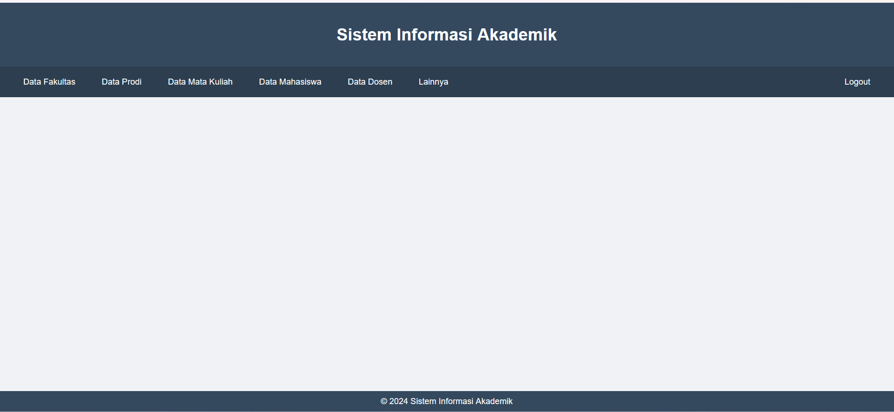
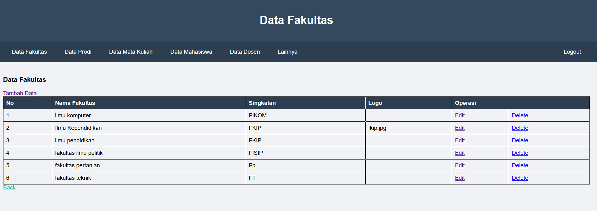
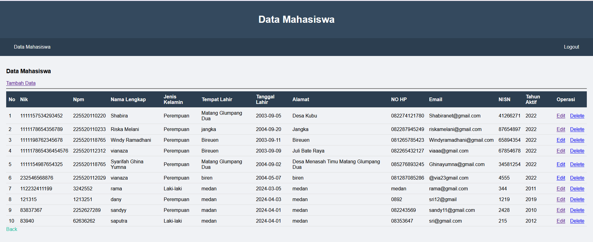
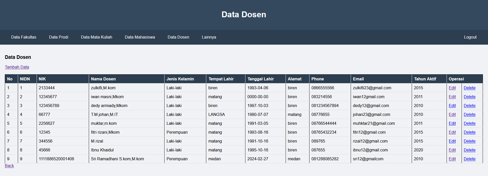
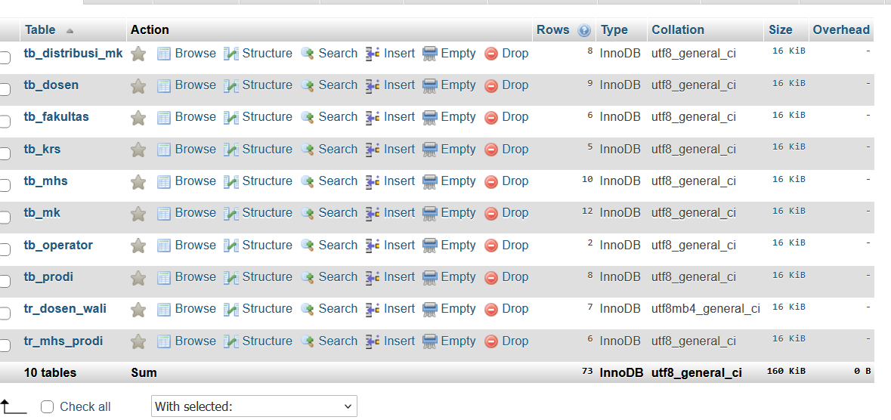

# Sistem Informasi Akademik Kampus

## 📌 Deskripsi Proyek
Sistem informasi akademik berbasis web yang dikembangkan 
untuk mendukung pengelolaan data akademik kampus secara 
digital. Proyek ini dikembangkan pada Semester 4 sebagai 
implementasi mata kuliah Pemrograman Web.

## 🎯 Fitur Utama
- CRUD Data Fakultas
- CRUD Data Program Studi
- CRUD Data Mata Kuliah
- CRUD Data Mahasiswa
- CRUD Data Dosen
- Autentikasi Login Admin

## 🛠️ Tech Stack
- **Backend**: PHP Native
- **Frontend**: HTML, CSS, JavaScript
- **Database**: MySQL

## 📸 Screenshot Sistem

### Halaman Dashboard

### Data Fakultas

### Data Mahasiswa

### Data Dosen

### Database

## 🚀 Cara Menjalankan
1. Import file `database.sql` ke MySQL/phpMyAdmin
2. Letakkan folder project di `htdocs` XAMPP
3. Jalankan XAMPP (Apache + MySQL)
4. Akses: `http://localhost/nama-folder`

## 👤 Developer
Sri Ramadhani
S1 Informatika — Universitas Almuslim (2026)
IPK: 3,90 | Cumlaude | Wisudawan Terbaik 2026
📧 sriramadani596@gmail.com
